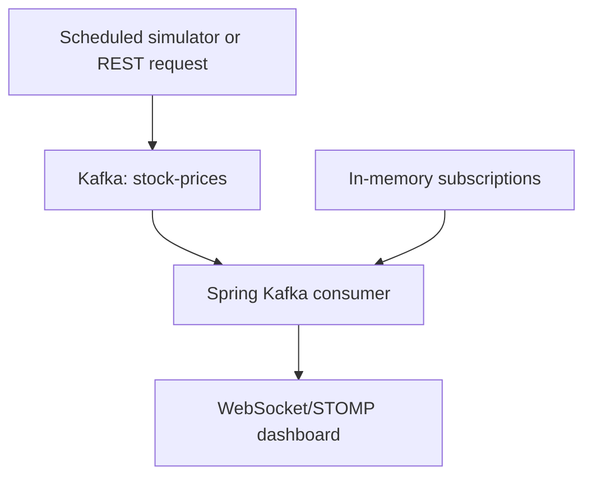
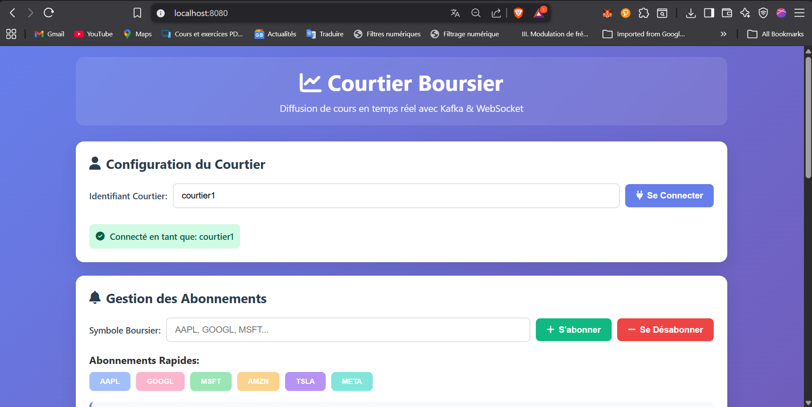
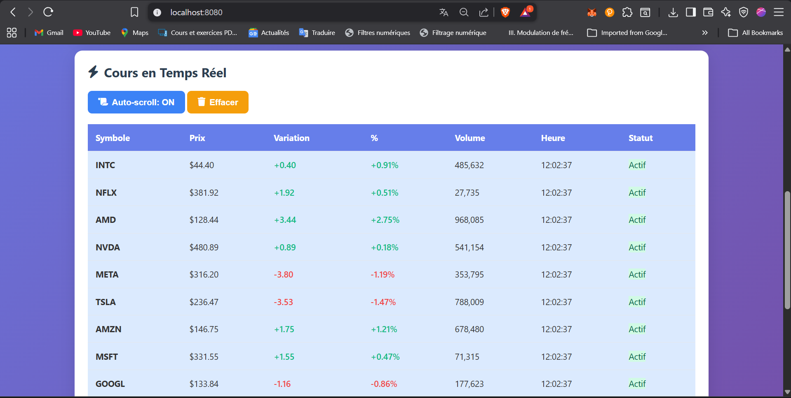
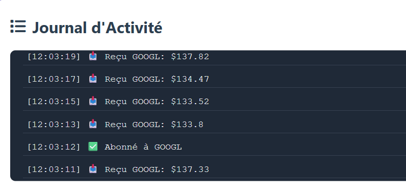

# Stock Broker — Kafka & Spring Boot

An educational real-time dashboard for **simulated stock prices**. A scheduled
producer publishes ten symbols to Kafka every two seconds; a consumer forwards
updates to the browser over WebSocket/STOMP.

Built by **SAWADOGO S. Abdel K Nourou** at the Faculté des Sciences et Techniques
de Settat. Academic supervisor: Mr Marzouk.

## What it demonstrates

- Event streaming with a keyed Kafka topic, `stock-prices`.
- Spring Boot REST endpoints for broker subscriptions and manual price publication.
- A browser dashboard using SockJS/STOMP, with a price table and activity log.
- In-memory broker-to-symbol and symbol-to-broker indexes, updated atomically.
- Java tests and a Spring application smoke test using an embedded Kafka broker.

The data is generated randomly around fixed reference prices. There is no market
data provider, order execution, portfolio management, or connection to a brokerage.

## Architecture



Kafka records are keyed by symbol. The consumer broadcasts to:

| Destination | Purpose |
| --- | --- |
| `/topic/stocks/{brokerId}` | Symbols subscribed to by that broker ID |
| `/topic/stocks/public` | All generated prices |
| `/topic/stocks/symbol/{symbol}` | Updates for one symbol |

The current dashboard also listens to the public channel, so its price table
shows all simulated symbols; broker subscriptions control the personal channel
and its receipt log. Broker IDs are demo labels, not authenticated identities.

## Run locally

Requirements: **JDK 17**, Docker with Compose, and an internet connection for the
first Maven dependency download. The checked-in Maven wrapper supplies Maven;
a separate Maven installation or IDE is unnecessary.

```bash
git clone https://github.com/abdel-saw/stock-broker-app.git
cd stock-broker-app
docker compose up -d
docker compose exec kafka kafka-topics --bootstrap-server localhost:9092 --list
bash mvnw spring-boot:run
```

If the Kafka check fails while the containers start, wait for startup and run it
again before launching Spring Boot. Open **http://localhost:8080**. The dashboard
connects as `courtier1`; use a quick subscription button to start a personal feed.
There are no preconfigured subscriptions.

On Windows, use `.\\mvnw.cmd spring-boot:run` in place of the Bash command.

The Compose file runs Kafka and ZooKeeper; Spring Boot runs on the host. Kafka
advertises `localhost:9092`, so the supplied setup is not an app-in-container
deployment. Stop the app with Ctrl+C and stop the broker with:

```bash
docker compose down
```

## Try the API

```bash
curl http://localhost:8080/api/stocks/test
curl -X POST http://localhost:8080/api/brokers/demo/subscribe/AAPL
curl http://localhost:8080/api/brokers/demo/subscriptions
curl http://localhost:8080/api/brokers/demo/is-subscribed/AAPL
curl -X POST 'http://localhost:8080/api/stocks/publish/simple?symbol=AAPL&price=172.50'
curl -X DELETE http://localhost:8080/api/brokers/demo/unsubscribe/AAPL
```

| Method | Path | Result |
| --- | --- | --- |
| GET | `/api/stocks/test` | HTTP process check; does not verify Kafka connectivity |
| POST | `/api/stocks/publish` | Publish a StockPrice JSON request |
| POST | `/api/stocks/publish/simple?symbol=AAPL&price=172.50` | Publish a price with defaults |
| POST | `/api/brokers/{id}/subscribe/{symbol}` | Add a subscription |
| DELETE | `/api/brokers/{id}/unsubscribe/{symbol}` | Remove a subscription |
| GET | `/api/brokers/{id}/subscriptions` | List a broker's symbols |
| GET | `/api/brokers/{id}/is-subscribed/{symbol}` | Check a subscription |
| GET | `/api/brokers/subscriptions/all` | List all demo subscriptions |

Broker IDs are trimmed and case-sensitive. Symbols are trimmed and normalized
to uppercase independently of the server locale. Duplicate subscriptions are
idempotent. Blank IDs or symbols return HTTP 400. Subscription reads return
immutable snapshots; concurrent updates cannot leave the two indexes out of sync.

## Tests and build

```bash
bash mvnw --batch-mode --no-transfer-progress verify
java -jar target/stock-broker-app-0.0.1-SNAPSHOT.jar
```

Tests start an embedded Kafka broker on random ports; **Docker and an external
Kafka instance are not needed to run the tests**. Running the packaged application
still requires the broker started in the local setup above.

GitHub Actions runs the same verification command on pull requests and main.
Tests cover subscription normalization, duplicate/removal behavior, immutable
snapshots, invalid input, locale independence, concurrent operations, and
application startup with Kafka.

## Stack and source map

| Component | Implementation |
| --- | --- |
| Runtime | Java 17, Spring Boot 3.2.0 |
| Messaging | Spring Kafka; Confluent 7.5.0 Kafka/ZooKeeper images |
| Browser transport | Spring WebSocket, STOMP, SockJS |
| Build | Maven wrapper, Lombok |
| Entry point | `src/main/java/com/stockbroker/StockBrokerApplication.java` |
| REST API | `src/main/java/com/stockbroker/controller/` |
| Producer, consumer and subscriptions | `src/main/java/com/stockbroker/service/` |
| Web UI | `src/main/resources/static/` |
| Configuration | `src/main/resources/application.properties` |

## Scope and hosting

This is a single-application learning project. Subscriptions disappear on restart,
the local Kafka setup uses one broker, and the WebSocket broker is in-process.
The API has no authentication or access control; the all-subscriptions route is
not an administrative boundary despite its original controller comment.
The manual-publish response also does not guarantee Kafka delivery.

No cloud demo is configured. The backend needs a reachable Kafka service;
uploading the HTML to GitHub Pages alone will not provide live functionality.
Before publishing a shared demo, the next work is input/output hardening,
controlled publication, reliable delivery feedback, and a tested hosting design.
No availability, resilience, or throughput benchmark is claimed.

## Screenshots and report





- [Original architecture illustration](screenshots/architecture.png)
- [Academic project report](<Rapport_Projet_Courtier .pdf>)

The report and screenshots describe the original academic implementation;
the source and automated checks reflect the current repository.
